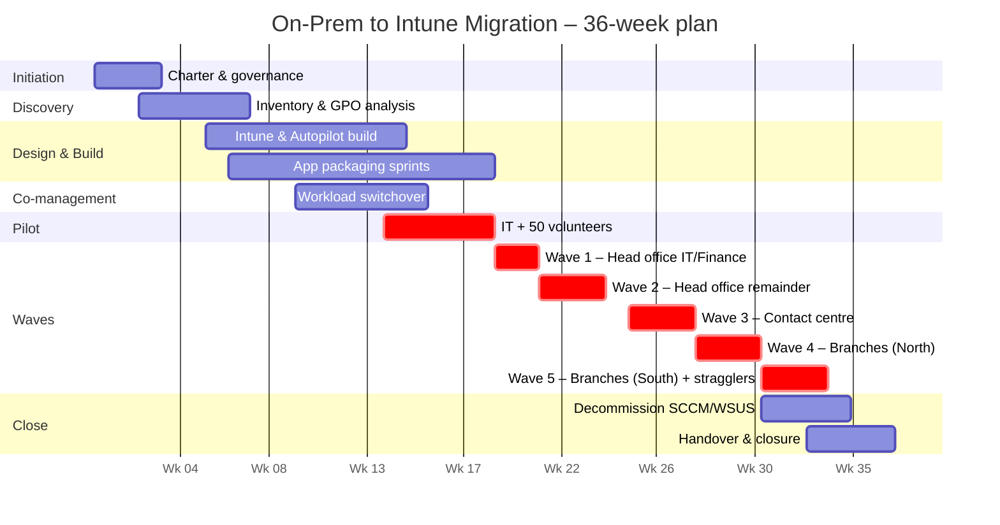

# 02 – Delivery Plan

**Project:** Modern Endpoint Management – On-Prem to Intune Migration
**Organisation:** Harbourside Building Society (fictional)
**Duration:** 36 weeks | **Approach:** Stage-gated phases, agile sprints within build and waves

---

## 1. Phases and stage gates

| Phase | Weeks | Key outputs | Exit gate |
|---|---|---|---|
| **0. Initiation** | 1–3 | Charter, business case, governance, resourcing, RAID baseline | Gate 0 – Approval to proceed |
| **1. Discovery** | 3–7 | Device and app inventory, GPO analysis, network assessment, user personas | Gate 1 – Design approved |
| **2. Design & Build** | 6–14 | Intune tenant config, Autopilot profiles, policy baselines, app packaging (sprints), Autopatch rings, Conditional Access | Gate 2 – Ready for pilot |
| **3. Co-management** | 10–15 | SCCM co-management enabled; compliance, updates and Endpoint Protection workloads moved to Intune | (Tracked within Gate 2/3) |
| **4. Pilot** | 14–18 | IT team + 50 volunteers migrated; feedback, defect fixes, wave runbook finalised | Gate 3 – Go/no-go for waves |
| **5. Deployment Waves 1–5** | 18–32 | ~2,250 devices migrated in five waves | Go/no-go before each wave |
| **6. Decommission** | 31–34 | SCCM, WSUS and distribution points retired, servers removed | Gate 4 – Decommission approved |
| **7. Handover & Closure** | 33–36 | BAU handover, closure report, lessons learned, benefits tracking plan | Gate 5 – Project closed |

## 2. Timeline

## 3. Wave schedule

| Wave | Group | Devices | Weeks | Notes |
|---|---|---|---|---|
| Pilot | IT department + 50 volunteers (every department, 3 branches) | 120 | 14–18 | Volunteers chosen to cover every persona and app bundle |
| 1 | Head office – IT, Finance, HR | 310 | 18–19 | Finance avoids month-end; scheduled for week after close |
| 2 | Head office – remaining departments | 520 | 20–22 | Includes executives (white-glove service) |
| 3 | Contact centre | 480 | 23–25 | Migrated in shift blocks outside peak call hours |
| 4 | Branches – North (7 branches) | 440 | 26–28 | Devices pre-provisioned (Autopilot white glove) to cut branch bandwidth use |
| 5 | Branches – South (7 branches) + stragglers | 430 | 29–31 | Includes catch-up for devices missed in earlier waves |
| | **Total** | **~2,300** | | |

## 4. Wave runbook (per wave)

| When | Activity | Owner |
|---|---|---|
| T-10 days | Device list confirmed, app bundles checked against user group, CAB change raised | PM / Packaging Lead |
| T-7 days | User announcement email + manager briefing (see [Comms Plan](04-stakeholder-comms-plan.md)) | Change Manager |
| T-3 days | Go/no-go meeting | PM (chair) |
| T-1 day | Reminder to users: save files to OneDrive, note any local apps | Change Manager |
| T-0 | Devices reset to Autopilot; floor-walkers on site; hypercare channel open | Technical Lead / Service Desk |
| T+1 to T+10 | Hypercare: daily ticket review, defect fixes, user survey | Service Desk Manager |
| T+10 | Wave closure review – metrics, lessons, adjustments for next wave | PM |

## 5. Go/no-go criteria (each wave)

A wave proceeds only if **all** of the following are met:

- [ ] Previous wave: open P1/P2 incidents = 0, P3 backlog < 20
- [ ] Previous wave: ≥ 97% devices successfully enrolled and compliant
- [ ] All business-critical apps for this wave's users tested and signed off by app owners
- [ ] CAB approval received
- [ ] Floor-walker and service desk rota confirmed
- [ ] No conflict with business-critical events (month-end, rate change, regulatory reporting)
- [ ] Rollback route confirmed (spare pre-provisioned devices on site, ≥ 5% of wave size)

## 6. Key milestones

| # | Milestone | Week | Status |
|---|---|---|---|
| M1 | Gate 0 – Charter approved | 3 | ✅ Complete |
| M2 | Gate 1 – Design approved | 7 | ✅ Complete |
| M3 | Co-management live, update workloads in Intune | 13 | ✅ Complete |
| M4 | Gate 2 – Ready for pilot | 14 | ✅ Complete |
| M5 | Gate 3 – Pilot complete, waves approved | 18 | ✅ Complete |
| M6 | All head office devices migrated | 22 | ✅ Complete |
| M7 | All branches migrated | 31 | ✅ Complete |
| M8 | SCCM and WSUS decommissioned | 34 | ✅ Complete |
| M9 | Gate 5 – Project closed | 36 | ✅ Complete |

## 7. Resourcing

| Role | FTE | Phases |
|---|---|---|
| Project Manager | 1.0 | All |
| Technical Lead / EUC Architect | 1.0 | 1–6 |
| Intune Engineers | 2.0 | 2–6 |
| App Packagers (incl. partner) | 3.0 | 2–5 |
| Service Desk liaison | 0.5 | 4–7 |
| Change & Comms Manager | 0.5 | 1–7 |
| Floor-walkers | 4–6 (wave days) | 4–5 |
